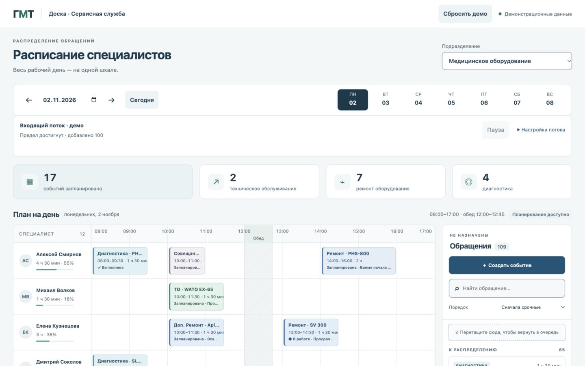
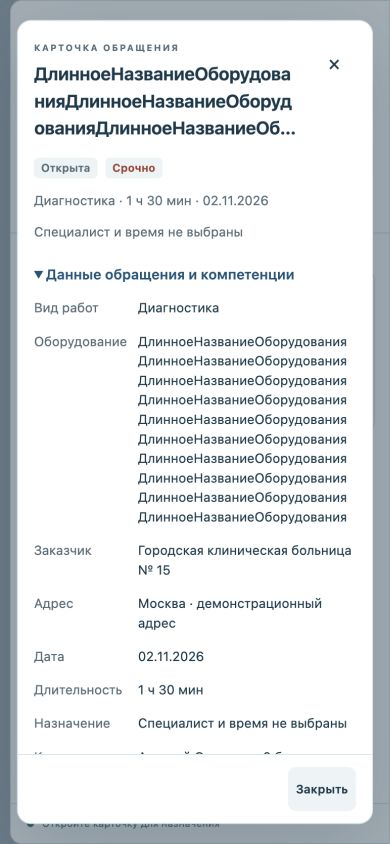

# Повторная итоговая проверка GMT-01…GMT-08

Выполнена по прямому запросу владельца повторно пройти функционал по всем пунктам плана. Новый продуктовый GMT-09 не создавался.

Живой прогон: 2026-11-02T15:22:53+04:00 — 2026-11-02T15:36:34+04:00. Основные доступные сценарии всех восьми пунктов прошли; новых дефектов приложения не обнаружено, исходники не менялись. Общего утверждения «всё PASS» нет: ограничения среды перечислены ниже.

В журнале 124 контрольных наблюдения: 117 PASS, 3 группы SKIPPED_ENVIRONMENT, 4 INFO. Это число наблюдений, включая этапы одного сценария, а не столько независимых тест-кейсов. [Полный журнал с фактическими результатами и UTC-временем](2026-11-02-full-recheck/evidence.json).

## Среда и сохранность данных

Computer Use встроенного браузера iab: Playwright locators для форм/кнопок, нативные drag/клавиши/прокрутка для соответствующих действий. Версия движка инструментом не предоставлена; полный прогон отдельного Google Chrome не заявляется. evaluate читает только DOM и геометрию, бизнес-операции им не вызывались. Входящие JSON передавались через существующую изолированную форму источника.

Основные сценарии — http://127.0.0.1:8765/ с mockStorage=memory и fault-injection режимами. Временные часы для статусов: mockNow=2026-11-02T09:37. Проверка настоящего localStorage и reload выполнена в отдельном origin http://localhost:8765/ той же локальной страницы; это отдельное хранилище от рабочего 127.0.0.1. Созданные там четыре тестовых ручных события оставлены в тестовом origin, поток поставлен на паузу, интервал возвращён на 10 секунд, временная вкладка закрыта. Рабочее демо не сбрасывалось.

До/после сравнили дату, подразделение, ID/подписи всех календарных карточек, число очереди и состояние потока. Снимки полностью совпали: 17 назначений, 109 в очереди, предел потока 100. [Исходный DOM-снимок](2026-11-02-full-recheck/baseline.json). Обычная вкладка оставлена на http://127.0.0.1:8765/, без mock-параметров и viewport override.

## Покрытие плана

| Пункт | Повторно выполненные живые сценарии | Результат |
| --- | --- | --- |
| GMT-01 | Загрузка 13/7 в чистом демо, русские подписи/график; поиск/пустой результат; сортировка по длительности в обе стороны и срочности; смена подразделения/даты без чужих карточек; ошибка источника/Retry; обе прокрутки и закреплённые имена/шкала | PASS |
| GMT-02 | Назначение 09:00–10:00; отказ 10:15, успех 10:30; сосед справа; конец ровно12:00 и начало12:45; отказ за пределами дня и на обеде; отсутствие/компетенции/скоринг0/пустой и отсутствующий backups; readonly; возврат; reload; отмена/подтверждение reset; write-error/corrupt/unavailable | PASS |
| GMT-03 | Настоящий drag очередь→календарь, внутри строки с шагом15, между специалистами, обратно; ручное событие; горизонтальная+вертикальная прокрутка; запреты промежутка/обеда/компетенции/отсутствия; readonly data-draggable=false; отпускание вне цели; reload после drag; мобильная альтернативная форма | PASS основных направлений; held-drag ограничения ниже |
| GMT-04 | Все четыре типа, пустое описание,0/отрицательная/дробная длительность; двойной клик при задержке; mock-ошибка и повтор; отмена с ожиданием дольше ответа; безопасный HTML-подобный текст; слишком длинное событие; назначение формой/DnD; восстановление созданных событий | PASS |
| GMT-05 | Запланирована→В работе→Выполнена; запреты завершения до начала и в будущем; запрет раннего старта; досрочно09:37 с исходным планом09:00–11:00 и историей;10:00 запрещено/10:15 разрешено от факта; завершение без старта с задержкой7мин; completed не draggable; отложить/назначить с сохранённой эскалацией; reload факта | PASS |
| GMT-06 | Успех и обе даты без дубля; reload целевой даты; отказ при занятости,15-минутном промежутке, другом обеде, отсутствии, выходном, readonly; mock-ошибка/повтор;30.11→01.12 и31.12→01.01; отмена через закрытие и смену подразделения во время запроса | PASS |
| GMT-07 | Три стандартных10-секундных цикла; интервал1сек и предел; прямая пауза13сек; увеличение предела/возобновление; malformed JSON/объект/длительность; повторы message ID и task ID после старта; другой контекст при переключении; WS во время настоящего drag; ввод/фокус/queue scroll500 сохранены при двух поступлениях; применение формы по свежим данным; настройки после reload; reset возвращает единственный10-секундный поток | PASS |
| GMT-08 | Пять контрольных размеров; длинные имя/модель/описание; короткая15-минутная карточка; заполненная очередь; пустой календарь/поиск; Tab/Shift+Tab/Escape/возврат фокуса; мобильное назначение; reflow720×450; осмотр снимков и консоли | PASS доступных проверок; actual zoom/reduced-motion ниже |

Детали отдельных наблюдений:

- При стандартном WS за32.24сек пришло3 задачи: очередь7→10, черновик и focus create-description сохранены.
- На1сек/предел5 поток остановился на5. На прямой паузе generated2 не изменился за13.036сек.
- После сброса из режима1сек/предел5 через128.819сек наблюдалось12 поступлений при10сек. Признаков умножения таймеров нет.
- Форма назначения при2 доставках сохранила Анну/10:15, фокус assignment-time, прокрутку очереди500, календаря0 и диалога0. Назначение успешно применилось после доставки.
- В DnD после прокрутки ручное обучение назначено Виктору14:00–15:00. Отказ в строке отсутствующего Олега исходное назначение не изменил.
- Повтор WS после старта сохранил одну карточку «В работе» у Виктора10:00–10:30.
- Проверка reset касается только изолированных mock storage. Неизменность иных ключей localStorage через искусственный чужой ключ не тестировалась; одноимённый ключ GMT и изоляция adapters ранее проверены кодом, рабочий origin подтверждён сравнением DOM.

## Вёрстка и доступность

| Размер | Ширина страницы | Видимая/полная ширина календаря | Снимок |
| --- | --- | --- | --- |
| 1920×1080 |1920|1488/1488|[1920](2026-11-02-full-recheck/size-1920.jpg)|
| 1440×900 |1440|1038/1038|[1440](2026-11-02-full-recheck/size-1440.jpg)|
| 1280×800 |1280|878/1010|[1280](2026-11-02-full-recheck/size-1280.jpg)|
| 768×1024 |768|726/1010|[768](2026-11-02-full-recheck/size-768.jpg)|
| 390×844 |390|364/958|[390](2026-11-02-full-recheck/size-390.jpg)|

При scrollLeft132/scrollTop846 имя остаётся x33, равным левому краю календаря; шкала y319.195 совпадает с верхним краем контейнера. Горизонтальная прокрутка находится внутри календаря.

Длинный текст в мобильном диалоге: clientWidth=scrollWidth=354, заголовок81px, полная модель доступна в подробностях. Shift+Tab с close-details ведёт на нижнее «Закрыть», Tab возвращает на close-details, Escape возвращает фокус карточке очереди. Короткое15-минутное событие открывает подробности и содержит полную доступную подпись. Reflow720×450: страница720, высота диалога410, нижняя граница кнопок429 — действия доступны.

Контраст и правило reduced motion в исходниках не менялись после независимого GMT-08. Численные результаты контраста см. [GMT-08](GMT-08.md); новый автоматический accessibility-аудит не запускался. Снимки текущей вёрстки осмотрены, но визуальный осмотр не выдаётся за повторный расчёт всех цветовых сочетаний.

## Ограничения среды

1. **SKIPPED_ENVIRONMENT — реальный zoom200%.** В текущем прогоне super+plus снова не изменил innerWidth1440/devicePixelRatio1; API zoom нет. Проверка эквивалентной CSS-области720×450 выполнена отдельно и не названа настоящим масштабированием.
2. **SKIPPED_ENVIRONMENT — переключение reduced motion.** В API нет изменения media preference. Наличие CSS правила подтверждается исходниками, runtime переключение не выполнялось.
3. **SKIPPED_ENVIRONMENT — удерживаемый drag.** Доступный drag(from,to) атомарен. Нет документированного удержания для Escape посреди drag, длительной автопрокрутки и снимка активного preview. Основные реальные drag-направления и WS во время жеста выполнены повторно.

## Диагностика ошибок тестового инструмента

- Старая браузерная привязка вернула browser.user unavailable; сброс только REPL и повторная привязка той же вкладки восстановили управление.
- Один селектор ошибочно назывался assignment-competence; DOM показал действующий assignment-score, затем подтверждено0 баллов.
- Попытка возобновления на уже достигнутом пределе3 была заблокирована disabled-кнопкой, как и требуется. После увеличения предела до5 следующий этап выполнен. Запись07-paused-setting подтверждает предел, а прямую паузу подтверждает07-pause-direct.
- Общие вспомогательные функции первоначально удерживали вкладку memory при переходе к localhost. Созданные ID относились к memory, поэтому их отсутствие в localhost не было потерей данных приложения. Привязка диагностирована; затем все четыре типа созданы и persistence проверен функциями с явным persistTab.
- Два ранних снимка reset с queue «—» были сделаны во время асинхронной загрузки; они переведены в INFO. Последующее busy=false,13 назначений и8 в очереди (уже пришла1 WS-задача) подтверждает завершение. Промежуточная загрузка не объявлена PASS финального состояния.

Это диагностированные ошибки/ограничения проверочного инструмента. Повторы выполнялись после устранения причины, а не ради зелёного результата.

## Проверки кода и независимое ревью свидетельств

Код не изменялся: предыдущие исправления и независимое ревью GMT-08 сохраняют силу. Новый независимый проверяющий /root/final_recheck_review сверил покрытие плана с журналом. По его замечаниям уточнены промежуточные reset-снимки, добавлены прямое ожидание паузы и сохранность прокрутки; существенных пробелов в доступных сценариях не осталось. Финальная независимая сверка отчёта — APPROVE: числа, журнал, ссылки/снимки и хеши подтверждены, открытых замечаний нет. Проверяющий дополнительных runtime-проверок не выполнял.

Повторно node --check app.js — PASS; HTTP-байты всех трёх файлов совпадают с диском. Финальная консоль основной вкладки error/warn пустая. Backend units/build, отдельные lint/CSharpier/i18n — NOT_APPLICABLE; frontend units и сканеры не создавались.

| Файл | SHA-256 |
| --- | --- |
| index.html |52a48c225959a9a4c9dcc2c43c96ebcdbd3f58d1b6b0a3e89346aea3b74660a5|
| styles.css |d55b5051e8a7f224f8e73fc2480aafb55d279c3432f277ef09c614756b57a4c7|
| app.js |e947ee99780865c99adf005946a251499b09c500ad4fab5ce0fb8ef19679b21e|

Сервер не перезапускался, новые серверные процессы не создавались, Git writes не выполнялись. TODO MCP по-прежнему pending-sync; .todo не читался/не редактировался. Приложение доступно по прежнему адресу, запуск из корня при свободном порте: python3 -m http.server 8765 --bind 127.0.0.1.

