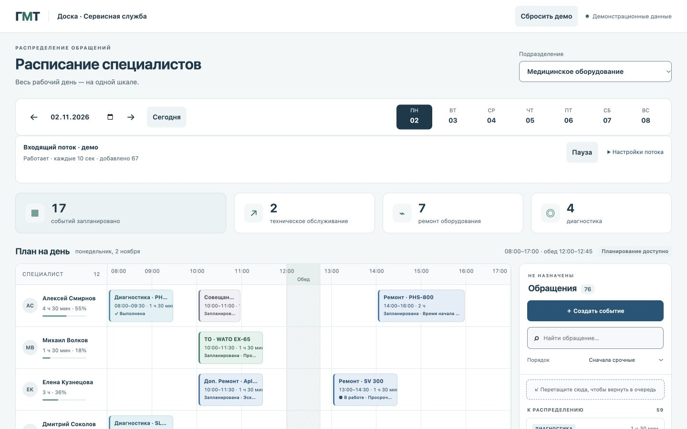
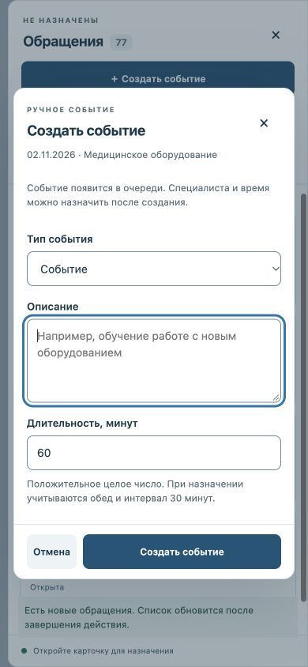

# GMT-08 — Итоговая проверка и fluid-вёрстка

Начало: 2026-11-02T14:56:45+04:00. Завершение: 2026-11-02T15:06:53+04:00.
Результат: основные функции и контрольные размеры PASS, независимое ревью APPROVE, открытых существенных дефектов нет. Вспомогательные ограничения среды указаны отдельно; они не объявлены PASS.

## Исправления и ревью

Независимый ревьюер /root/gmt08_review проверил итоговые HTML/CSS/JS, права permitted, общий валидатор, статусы, перенос, WS и безопасность текстового вывода. Исправлены три P2:

1. Непрерывные длинные строки переполняли карточку. До исправления ширина содержимого диалога была 2220 px при области 354 px. Теперь ширины равны 354 px; очередь 378/378 px. Заголовки ограничены тремя строками, имя специалиста двумя; полный текст оборудования доступен в подробностях, имя — в DOM и title.
2. Общая нормализация могла принять объект вместо текстового поля и сохранить его до ошибки отображения. validateTaskText теперь используется до мутаций как в normalize, так и в WS; проверяются optional model/client/text, тип отсутствия, безопасная целая длительность. Изолированный mockData=invalid-text отклоняется с объяснением; повторная загрузка даёт 13 назначений и 7 обращений. Это live-проверка общего пути normalize, а атомарность Update* дополнительно подтверждена ревью кода.
3. Границы полей были слишком светлыми. Новый #708b99 даёт 3.59:1 на белом и 3.33:1 на #f3f7f8. Основной muted-текст — 5.51:1 на белом, фокус — 4.89:1. Это расчёт конкретных цветов, не автоматический аудит всей страницы.

Повторное ревью закрывает все три замечания и последующую правку ограничения заголовков. Fixtures mockData=long-text/invalid-text доступны только при mockStorage=memory, нормальное сохранённое демо не изменяют. Новых зависимостей и production-файлов нет.

| Файл | Проверенный SHA-256 |
| --- | --- |
| index.html | 52a48c225959a9a4c9dcc2c43c96ebcdbd3f58d1b6b0a3e89346aea3b74660a5 |
| styles.css | d55b5051e8a7f224f8e73fc2480aafb55d279c3432f277ef09c614756b57a4c7 |
| app.js | e947ee99780865c99adf005946a251499b09c500ad4fab5ce0fb8ef19679b21e |

После финального ревью: node --check app.js, уникальные HTML ID и совпадение HTTP-содержимого трёх файлов с исходниками — PASS. Backend units/build и отдельные lint/CSharpier/i18n — NOT_APPLICABLE: соответствующей инфраструктуры нет. Frontend units и сканеры не запускались.

## Живые проверки

Использована существующая вкладка встроенного браузера (провайдер iab, Computer Use с Playwright locators и нативными клавишами/прокруткой). Версия движка не предоставлена инструментом; отдельный Google Chrome в GMT-08 не запускался. evaluate использовался только для чтения DOM/геометрии. Пользовательские операции выполнены через UI; тестовое входящее JSON-сообщение передано через изолированную форму источника.

Устаревшая привязка вкладки сначала вернула browser.user unavailable. Сброс только REPL и повторная привязка той же вкладки восстановили доступ. Не было новых браузерных процессов, установки расширений или headless-восстановления.

| Проверка GMT-08 | Фактическое свидетельство | Результат |
| --- | --- | --- |
| 1920×1080 | Осмотр заполненного расписания и очереди, читаемые панели | PASS |
| 1440×900 | Ширина страницы 1440, календарь без горизонтального overflow, очередь справа | PASS |
| 1280×800 | Страница 1280, календарь прокручивается внутри 878 px, содержимое 1010 px | PASS |
| 768×1024 | Страница 768, календарь 726/1010 px, очередь отдельной панелью | PASS |
| 390×844 | Страница 390, календарь 364/958 px, создание события и очередь доступны | PASS |
| Закрепление шкалы/имён | При scrollLeft=284, scrollTop=565 имя остаётся x=21, шкала у верхнего края календаря | PASS |
| Длинные строки | Long model/name/description; после исправления нет горизонтального переполнения, полное название в подробностях | PASS |
| Клавиатура | Shift+Tab с первого элемента диалога переходит к «Закрыть»; Tab возвращает цикл; Escape закрывает карточку с возвратом в очередь; следующий Escape возвращает фокус open-queue | PASS |
| Ошибочный источник | Неверный тип description отклонён до отображения; Retry восстанавливает нормальные данные | PASS |
| Пустые состояния | 07.11: нет назначений; несуществующий поиск: объяснение и сброс поиска | PASS |
| Заполненная очередь | Обычное демо содержит 76 обращений на момент возврата; прокрутка и поиск доступны | PASS |
| Входящее → назначение → перенос | JSON gmt08-flow-task принят; Виктор 08:30–09:30 → 09:00–10:00 | PASS |
| Начало и досрочное завершение | При mockNow=2026-11-02T09:37: В работе → Выполнена, занятость 09:00–09:37 | PASS |
| Следующее ручное событие | Создано событие 15 минут; 10:00 отклонено из-за 30 минут, 10:15–10:30 разрешено | PASS |
| Отложить и повторно назначить | Задача возвращена в очередь «Отложена», назначена Виктору 10:15–10:30 без дубля | PASS |
| Завтра в связанном проходе | Переход на 03.11 показывает того же Виктора, 10:15–10:30, статус Запланирована | PASS |
| Сброс | Подтверждение только в изолированном memory-демо; исходные 7 в очереди, gmt08-flow отсутствует, поток 10 сек/0 | PASS |
| Восстановление рабочего демо | Нормальный URL: 5 прежних завершённых задач, назначения/очередь сохранены, warning скрыт, поток 10 сек активен | PASS |
| Консоль и загрузки | error/warn пуст; локальные HTML/CSS/JS доступны и совпадают с диском | PASS |
| Reflow 720×450 | Эквивалентная CSS-область для 1440×900 при 200%; ширина страницы 720, диалог 410 px по высоте, footer bottom=429 | PASS |
| Настоящий browser zoom 200% | super+plus не изменил innerWidth=1440 и devicePixelRatio=1; API управления zoom отсутствует. Reflow выше не назван настоящим zoom | SKIPPED_ENVIRONMENT |
| Reduced motion runtime | В разрешённом API нет переключателя media preference. CSS правило reduce отключает transition/animation и smooth-scroll, проверено кодом | SKIPPED_ENVIRONMENT |

## Матрица требований и повторно используемые результаты

Неизменившиеся результаты предыдущих TODO используются без повторного полного прогона. Проверка восстановления текущего демо дополнительно подтверждает совместимость усиленной нормализации с уже сохранёнными моделями.

| Требование | Свидетельство | Статус |
| --- | --- | --- |
| Русский светлый интерфейс, mock-календарь и исходные модели | GMT-01 + визуальный GMT-08 | PASS |
| График, обед, интервал с обеих сторон, компетенции/0, отсутствие | GMT-02; фактический конец повторён в GMT-08 | PASS |
| Форма и DnD между слотами/специалистами/очередью | GMT-02/03; WS во время настоящего drag в GMT-07 | PASS основных направлений |
| Ручные события, валидация, безопасный HTML-текст | GMT-04; создание/длинный текст в GMT-08 | PASS |
| Статусы, просрочка, фактический конец и история | GMT-05 + связанный GMT-08 | PASS |
| Перенос на завтра, конфликт и восстановление двух дат | GMT-06 + успешный связанный GMT-08 | PASS |
| Эскалация, readonly | GMT-01/02/05/06, изменения этих правил отсутствуют | PASS |
| WS, дубли, контексты, интервалы, формы/DnD, сохранение | GMT-07; общий путь валидации усилен GMT-08 | PASS |
| Хранилище, отказ, повреждение, сброс | GMT-02/06/07 + восстановление/изолированный reset GMT-08 | PASS |
| Fluid, длинные строки, модальные окна/клавиатура | GMT-08 выше | PASS, отдельные ограничения среды указаны |

Из GMT-03 сохраняются SKIPPED_ENVIRONMENT для Escape внутри удерживаемого drag, длительной автопрокрутки и визуального снимка активного preview: инструмент выполняет drag атомарно. Код этих ветвей прошёл ревью, главные направления DnD проверены. Это не новые продуктовые дефекты и не скрытое заявление об успешном runtime-тесте.

## Снимки





## Запуск и передача

Приложение: http://127.0.0.1:8765/. Из корня проекта без сборки:

```bash
python3 -m http.server 8765 --bind 127.0.0.1
```

Запускать команду только если порт свободен: уже работающий сервер GMT-01 оставлен для демонстрации. На этой сессии lsof подтвердил Python PID 69503, владелец sergei, LISTEN 127.0.0.1:8765; Повторное чтение identity/cwd через ps недоступно: operation not permitted сохраняется и при exact-action escalation; этот дополнительный процессный check — SKIPPED_ENVIRONMENT. Остановка/перезапуск не требовались, поэтому существующий сервер оставлен без изменений. Процессы не создавались/не останавливались. Чужой 8080 не затрагивался.

Обычная вкладка сохранена как результат, URL без mock-параметров. Модальные окна закрыты, временный viewport override сброшен. Текущая ширина после reset может соответствовать размеру панели приложения, это не принудительный viewport. Сохранённые пользовательские демо-данные не сбрасывались; входящий поток продолжает добавлять mock-задачи до заданного предела.

Все GMT-01…GMT-08 завершены с явно перечисленными ограничениями среды. Настоящие backend/API/WS и авторизация остаются вне утверждённого объёма. Git writes не выполнялись; PDF/README/LICENSE/.gitignore не менялись. Legacy cleanup не требуется для новых процессов: они не создавались, неизвестные ресурсы не удалялись. TODO MCP отсутствует, pending-sync; .todo не читался/не редактировался.

[План](../development/plans/2026-11-02-dashboard-plan.md) · [Память](../MEMORY.md)
